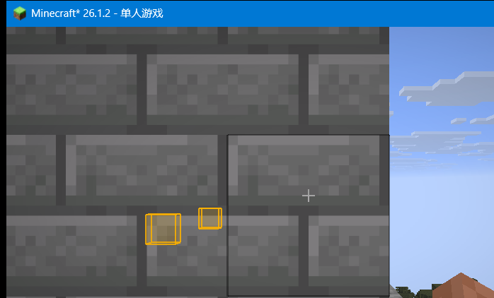

# ShelfESP

适用于 **Minecraft 26.1.2 + Fabric** 的客户端模组：高亮**装有物品的展示架（Shelf）**，并且像 ChestESP 一样**穿墙可见**。

只在单人世界使用也完全没问题；模组是纯客户端的，不改变方块、物品或服务端逻辑。



> 截图来自开发环境实测：玩家贴着一面石砖墙，墙后的两个装有物品的展示架仍会被高亮；空展示架不会高亮。

## 功能

- 扫描玩家周围已加载区块中的 `ShelfBlockEntity`；
- 只高亮**至少有一格非空物品**的展示架，空展示架不显示；
- 穿墙渲染：半透明填充 + 描边，可选从准星指向展示架的牵引线；
- 可配置颜色、透明度、最大距离、刷新间隔、显示样式；
- `H` 键快速开关（可在「选项 → 控制 → 按键绑定」中修改），开关时有动作栏提示；
- 开关状态会写回配置文件，下次启动保持。

## 环境要求

| 组件 | 版本 |
| --- | --- |
| Minecraft | 26.1.2 |
| Fabric Loader | ≥ 0.18.4（开发使用 0.19.5） |
| Fabric API | ≥ 0.155.3+26.1.2 |
| Java | 25+ |

> 26.1.x 的 Minecraft 已不再混淆，Fabric Loom 1.18 使用新的 `net.fabricmc.fabric-loom` 插件直接按 official 名称编译，因此本项目**不需要 Yarn/Mojmap 映射**。

## 安装

1. 安装 Fabric Loader 0.19.5+，并把 **Fabric API** 放进 `mods/`；
2. 把构建产物 `build/libs/shelfesp-1.0.0.jar` 放进 `.minecraft/mods/`；
3. 启动游戏。

## 配置

首次启动会生成 `config/shelfesp.json`：

```json
{
  "enabled": true,
  "style": "BOXES",
  "color": "#FFB300",
  "fillAlpha": 40,
  "outlineAlpha": 220,
  "tracerAlpha": 170,
  "maxDistance": 64.0,
  "updateIntervalTicks": 10,
  "drawFill": true,
  "drawOutline": true
}
```

| 字段 | 说明 |
| --- | --- |
| `enabled` | 总开关，也可按 `H` 切换 |
| `style` | `BOXES`（方框）、`TRACERS`（牵引线）、`BOXES_AND_TRACERS`（两者） |
| `color` | 高亮颜色，`#RRGGBB` |
| `fillAlpha` | 填充透明度 0–255 |
| `outlineAlpha` | 描边透明度 0–255 |
| `tracerAlpha` | 牵引线透明度 0–255 |
| `maxDistance` | 最大高亮距离（8–256 格） |
| `updateIntervalTicks` | 扫描间隔（客户端 tick，1–200） |
| `drawFill` / `drawOutline` | 是否绘制填充 / 描边 |

修改配置文件后重新进入世界或重启游戏生效。扫描半径会根据 `maxDistance` 自动收缩，不需要为了性能调小视距。

## 实现要点

- **入口**：`ShelfEspClient`（`ClientModInitializer`）注册按键与客户端 tick 回调；
- **扫描**：`ShelfScanner` 遍历玩家周围已加载区块的方块实体，过滤 `ShelfBlockEntity`，检查 `getItems()` 是否有非空 `ItemStack`，再用方块碰撞形状生成 `AABB`；
- **渲染**：`LevelRendererMixin` 在 `LevelRenderer.renderLevel(...)` 返回时注入，用相机相对坐标提交几何体；
- **穿墙**：`ShelfEspPipelines` 通过 access widener 调用 `RenderPipelines.register`，创建 `DepthStencilState` 为空的管线，从而完全忽略深度测试；
- **粗线**：`esp_lines.vsh` 在屏幕空间展开线段，支持 `LineWidth` 属性；
- **渲染类型**：`ShelfEspRenderTypes` 用 `RenderType.create` 包装管线。

## 构建

项目内已经带好 Gradle Wrapper，并且把依赖缓存固定在项目下的 `gradle-home/`：

```bat
build.bat
```

等价于：

```bat
set GRADLE_USER_HOME=%CD%\gradle-home
gradlew.bat build
```

首次构建会下载 Gradle、Loom、Minecraft 26.1.2、Fabric Loader/API 到 `gradle-home/`，之后可离线增量构建。

产物：

- `build/libs/shelfesp-1.0.0.jar` — 安装用模组；
- `build/libs/shelfesp-1.0.0-sources.jar` — 源码。

开发运行：

```bat
run-client.bat
```

## 验证情况

已在 26.1.2 开发客户端（Fabric Loader 0.19.5 + Fabric API 0.155.3）实际进服验证：

- 装有钻石 / 石头 / 绿宝石的展示架都会被高亮，空展示架不显示；
- 在玩家与展示架之间放置整面石砖墙后，高亮仍然穿墙可见；
- `H` 键可以关闭 / 打开高亮，动作栏分别提示 `ShelfESP disabled` / `ShelfESP enabled`；
- 关闭后高亮立即消失，重新打开后恢复。

## 已知限制

- 只识别 26.1 新增的 **Shelf** 方块（不包含 `chiseled_bookshelf` 等旧方块）；
- 只扫描客户端已加载的区块，未加载区域不高亮；
- 纯客户端模组，服务器不会知道它的存在；在多人服务器使用前请确认服务器规则；
- 26.1.2 是较新的版本，若后续小版本改动渲染 API，需要重新适配。

## 许可

GPL-3.0-or-later。渲染思路与宽线着色器参考了 ChestESP（Alexander01998，GPL-3.0-or-later），详见 `NOTICE`。
